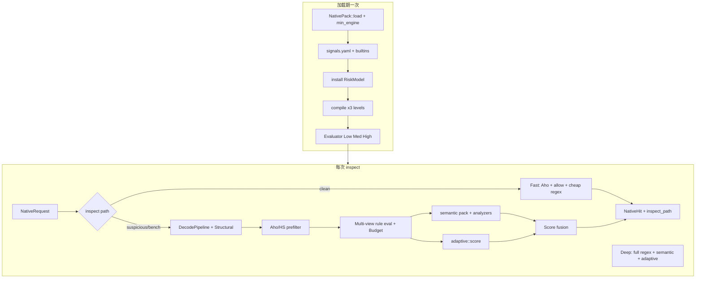

# Nerve Arc-Cortex Engine — 能力与技术说明

> 产品名：**Nerve Arc-Cortex**（弧-皮层检测引擎）· Slogan：*反射级响应，皮层级深检。*  
> 分层文档：[`arc-cortex/README.md`](./arc-cortex/README.md) · 术语：[`arc-cortex/terminology.md`](./arc-cortex/terminology.md)

> 文档版本：与引擎代码同步（baseline pack **1.5.43** / workspace `0.1.0`）  
> 代码根目录：`Nerve-waf-native/`

本文描述 **Arc-Cortex 检测内核**（crate `nerve-antibody-engine`）：分层能力、请求如何运转、关键技术细节。

规则编写、产品边界与加速后端细节见：

| 文档 | 内容 |
|------|------|
| [RULE-AUTHORING.md](./RULE-AUTHORING.md) | L1 谓词优先级、嵌套 when、signals、allow FP |
| [BOUNDARY-IP-GEO-RATE.md](./BOUNDARY-IP-GEO-RATE.md) | IP / Geo / 限流 **不在**引擎内 |
| [HYPERSCAN.md](./HYPERSCAN.md) | Hyperscan / Vectorscan 可选加速 |
| [ENGRAM-L3-HOOK.md](./ENGRAM-L3-HOOK.md) | L3 / Engram 接入原则（禁裸拦） |

---

## 1. 引擎定位

Nerve Native 是 **签名 + 异常分 + 偏执等级** 的可解释检测引擎，对标 OWASP CRS 的 paranoia / anomaly scoring 叙事：

| 层 | 名称 | 能否单独决定拦截 |
|----|------|------------------|
| L1 | 规则 + 评分 / allow | 能 |
| L2 | 语义分析（SQL / XSS / Path） | 只加分或 veto，不黑盒拍板 |
| L3 | 自适应风险分 | **不能**单独 block |

对外稳定入口：`nerve_antibody_engine::Engine`（WAF 侧仍通过 compat `nerve_antibody::Engine` 接入）。

可嵌入：

- **Dashboard**：`nerve-antibody-dashboard`（`:8790`）
- **Nerve-waf**：inspect 流水线 `expert` 段（`Nerve-waf` → `expert_bridge`）

### 1.1 能力边界（重要）

引擎负责 **HTTP 载荷签名 / 语义 / 自适应评分**。下列能力 **刻意不在** native L1：

- IP deny / 黑白名单
- Geo 国家/地区
- 连接或请求速率限流

归属 Edge / Control / APISIX 等前置层。详见 [BOUNDARY-IP-GEO-RATE.md](./BOUNDARY-IP-GEO-RATE.md)。

---

## 2. 当前已具备的能力

### 2.1 规则包与 DSL

| 能力 | 说明 |
|------|------|
| Pack 加载 | `pack.toml` + 递归 `rules/**/*.yaml` |
| 内容哈希 / 验签 | SHA256；可选 HMAC（`NERVE_NATIVE_PACK_KEY`） |
| **`min_engine` 强制校验** | 包要求引擎版本高于当前则拒绝加载 |
| 规则语法 | `when.all` / `when.any`；**可嵌套**（`WhenNode::Group`）；兼容旧 `match` |
| 谓词 | `contains`、`regex`、**`length_gt` / `length_lt`**、**`feature` / `fingerprint`** |
| 字段 | `uri` / `query` / `body` / `method` / `host` / `header` / **`response_body`** / feature / fingerprint |
| **具名 Header** | `field: header` + `header_name: User-Agent`（大小写不敏感） |
| 动作 | `block` / `observe`（含 `log`）/ **`allow`（负分豁免）** |
| 强度 | `min_level`: `low` \| `medium` \| `high` |
| 变换（规则级） | `lowercase`、`url_decode`、`url_decode_uni`、`html_entity_decode`、`html_numeric_decode`、`js_unescape`、`strip_null` |

**谓词成本**：`feature` / `fingerprint` / `length_*` / `contains` 优先于 `regex`。编写约定见 [RULE-AUTHORING.md](./RULE-AUTHORING.md)。

```yaml
# 嵌套 when：外层 any 多入口，内层 all = 门闩 ∧ 确认
when:
  any:
    - all:
        - feature: oauth_token_exchange
        - fingerprint: keycloak_token_path
    - all:
        - field: query
          length_gt: 4096
        - field: query
          contains: "access_token="
```

### 2.2 声明式信号（`signals.yaml`）

| 能力 | 说明 |
|------|------|
| 配置 | `[policy.signals]`：`enabled` + `pack_path`（baseline：`signals/signals.yaml`） |
| 种类 | `header_present` / `body_contains` / `query_param_present` / `length_gt` / `path_prefix` 等 |
| 引用 | 规则写 `feature: name` / `fingerprint: name`；与内置信号 **叠加** |
| 健康 | `NativeHealth.signals_enabled` / `signals_feature_count` / `signals_fingerprint_count` |

业务特征优先加 YAML，避免每加一个站点指纹就改 Rust。

### 2.3 引擎管线（`nerve-antibody-pipeline`）

| 能力 | 说明 |
|------|------|
| **DecodePipeline** | 引擎级多视图：raw / 归一化 / base64 候选展开 |
| **Structural** | form / JSON / multipart / path / **XML 轻量拆参** → `ParamUnit` |
| **InspectBudget** | `max_inspect_ms` + `max_regex_evals` 熔断 |
| **字段截断** | `max_field_chars`（默认 65536）：uri/query/body head-tail，防超大包拖垮 Deep |
| 证据 | 命中携带 `param_path` + `decode_chain` |

配置：`pack.toml` → `[policy.pipeline]`。

### 2.4 编译与加速

| 能力 | 说明 |
|------|------|
| 三档 Program | Low / Medium / High 各编译一份 |
| IR | `RuleExec` / `WhenExec`（嵌套 Group）/ `CondExec` |
| Contains 字典 + 倒排 | `dict_to_rules` |
| **Artifact format** | 当前写出 **format=3**；加载兼容 **format 2→3** 自动迁移 |
| **Accel 后端抽象** | `PatternBackend`：Aho / Hyperscan 风格 / 线性 |
| Aho-Corasick | 默认 feature `aho` |
| Hyperscan | feature `accel-hyperscan`（RegexSet 多模）；`accel-hyperscan-ffi` 可选原生 HS/Vectorscan |
| Artifact 缓存 | JSON 落盘；缓存键含 pack + engine format |

详见 [HYPERSCAN.md](./HYPERSCAN.md)。

### 2.5 运行时检测（热路径）

| 能力 | 说明 |
|------|------|
| 管线优先 | `build_views` → 预过滤 haystack 含解码视图 |
| 多视图匹配 | 整段字段 ∪ 拆参路径 ∪ base64 blob |
| 预算熔断 | regex/时间耗尽时停止精匹配并记录 `budget_exhausted` |
| 语义层 L2 | SQL / XSS / Path；支持 **veto**；semantic-pack YAML |
| 自适应 L3 | `RiskModel` trait；启发式 / **Linear JSON** / ONNX 入口；**Fusion**：禁裸模型硬拦 |
| 响应体 | `NativeRequest.response_body`；WAF 响应阶段优先 Native 引擎 |
| 热更新 | `Engine::reload`；WAF `POST /api/expert/reload` |
| **双路径 inspect** | `auto`：快路径（Aho + cheap regex，预算 ≤20ms）/ 深路径（全量 regex + L2 + L3）；bench 强制 `deep` |
| **Runtime 指标** | `nerve-antibody-metrics`；Dashboard `GET /metrics`、`GET /api/metrics` |
| **Stage-0 路由门闩** | `route_gate` 线性特征 → fast/deep；配置 `[policy.inspect.route_gate]` |
| **快路径轻量 pipeline** | `PipelineConfig::for_fast_path()` 跳过深解码/拆参 |
| **Shadow deep** | 快路径干净时异步深扫；FP 标注 → allow 草稿导出 |

### 2.6 语义包（L2 semantic-pack）

| 能力 | 说明 |
|------|------|
| 配置 | `[policy.semantic].pack_path = "semantic/signatures.yaml"` |
| 格式 | YAML `signatures[]`：`match: pattern`（regex）或 `match: token_seq` + `tokens[]` |
| 加载 | `Engine::load_pack` / `reload` → `install_semantic_pack` |
| 与内置关系 | pack 签名先匹配，再跑内置 analyzers；同类 score 取 max |

### 2.7 策略（pack 级）

```toml
[policy.threshold_by_level]
low = 40
medium = 36
high = 32

[policy.semantic]
enabled = true
pack_path = "semantic/signatures.yaml"

[policy.signals]
enabled = true
pack_path = "signals/signals.yaml"

[policy.inspect]
mode = "auto"          # auto | deep | fast；可被 NERVE_NATIVE_INSPECT_MODE 覆盖
fast_max_inspect_ms = 20

[policy.inspect.route_gate]
enabled = true
deep_threshold = 0.38

[policy.fusion]
min_independent_signals = 1   # 2 = 弱信号 block 需双证，降级 challenge

[policy.adaptive]
enabled = true
contribute = true
# model_path = "models/linear-v1.json"

[policy.pipeline]
decode_enabled = true
base64_expand = true
structural_enabled = true
max_decode_depth = 4
max_inspect_ms = 1200
max_regex_evals = 120000
max_field_chars = 65536       # 规则字段 head-tail；默认 65536
```

### 2.8 Observability 指标（Prometheus）

| 指标 | 含义 |
|------|------|
| `nerve_native_inspect_fast_total` / `inspect_deep_total` | 快/深路径分流 |
| `nerve_native_inspect_latency_bucket{le=...}` | 延迟分桶（1ms … 1200ms） |
| `nerve_native_budget_exhausted_ratio` | 预算熔断占比 |
| `nerve_native_rule_hits_total{rule_id=...}` | 规则命中 TopN |

详见 [arc-cortex/04-facade/metrics.md](./arc-cortex/04-facade/metrics.md)。

### 2.9 Shadow FP 闭环

| API | 说明 |
|-----|------|
| `GET /api/shadow/recent` | 最近深扫采样（含 `rule_id`） |
| `POST /api/shadow/feedback` | 标注 `fp` / `false_positive` / `allow` / `veto`（可选 `rule_id`） |
| `GET /api/shadow/export-rules` | 导出 YAML allow 草稿（含 feature/fingerprint 占位） |
| `Engine::shadow_export_rules` | 同上（引擎 API，勿破坏） |

---

## 3. 怎么运作（请求生命周期）



### 3.1 Fast / Deep

| 模式 | 触发 | 行为 |
|------|------|------|
| `fast` | `route_gate` 低风险 / 显式 `mode=fast` | Aho + allow + 廉价谓词；跳过深解码与 L2/L3 |
| `deep` | 可疑路由 / bench / `NERVE_NATIVE_INSPECT_MODE=deep` | 全量管线 + regex + semantic + adaptive |
| `auto`（生产默认） | pack `[policy.inspect].mode` | Stage-0 分流；可选双 worker 池 |

环境变量：`NERVE_NATIVE_INSPECT_MODE`、`NERVE_NATIVE_INSPECT_POOL`、`NERVE_NATIVE_SHADOW_DEEP`。

### 3.2 接入 WAF（challenge 映射）

```text
InspectPipeline → expert 段
  → expert_bridge::inspect_nerve_antibody
  → Engine::inspect
  → Native action → WAF WafAction
ResponseBody 阶段
  → inspect_nerve_antibody_response
运维
  → POST /api/expert/reload
  → GET  /api/expert/health
```

| Native `action` | 默认 WAF 映射 | 覆写 |
|-----------------|---------------|------|
| `block` | Block | — |
| `challenge` | **Challenge** | `NERVE_EXPERT_CHALLENGE_AS=challenge\|log\|block` |
| `observe` / 其它 | Log | — |

实现：`Nerve-waf/crates/engine/nerve-waf-inspect/src/expert_bridge.rs`。老部署若需「challenge 仅记日志」：设 `NERVE_EXPERT_CHALLENGE_AS=log`。

---

## 4. 技术细节

### 4.1 评分融合

```text
total = rule_score - allow_score + semantic_score + model_score
if semantic.veto: total = min(total, threshold - 1)
Fusion:
  强 L1 / 强 L2(block_eligible) / 弱规则∧模型 / 语义∧模型 / 攻击特征∧模型 → block
  裸模型不过阈 → observe；high 高置信裸模型 → challenge
  min_independent_signals≥2 时弱信号 block 降级 challenge
```

### 4.2 字段与视图

```text
raw field / ViewSlice →（可选）规则 transforms → contains/regex/length_*/feature/fingerprint
命中证据: "{param_path}|contains:..." + decode_chain[]
超长字段: head_tail(max_field_chars)
```

### 4.3 Artifact 兼容

| Format | 状态 |
|--------|------|
| 3（当前） | 嵌套 `when` IR；写出始终用 3 |
| 2 | 扁平 `All/Any(Vec<Cond>)`；加载时迁移为 format 3 |
| &lt;2 / &gt;3 | 拒绝；触发重编译 |

### 4.4 自适应模型

| 实现 | 版本串 | 说明 |
|------|--------|------|
| `HeuristicModel` | `heuristic-v1` | 默认 logit |
| `LinearModel` | JSON 权重 | 可校准真实线性模型 |
| `OnnxModel` | feature `onnx` | 加载入口（需链原生 Runtime） |

环境变量：`NERVE_NATIVE_MODEL` 指向权重文件。

### 4.5 Crate 地图

```text
nerve-antibody-engine       Facade: Engine / Health / reload / Shadow
├── nerve-antibody-pack     Pack + min_engine + policy.pipeline/signals
├── nerve-antibody-dsl      规则类型 + transforms + length/feature/fingerprint
├── nerve-antibody-signals  内置 + 声明式 feature/fingerprint
├── nerve-antibody-pipeline Decode / Structural / Budget
├── nerve-antibody-compiler Program / Artifact format 2–3
├── nerve-antibody-accel    MultiMatcher backends（Aho / HS optional）
├── nerve-antibody-runtime  Evaluator 热路径
├── nerve-antibody-semantic L2
└── nerve-antibody-adaptive L3 RiskModel
```

---

## 5. 能力对照（相对完整引擎管线）

| 能力 | 状态 |
|------|------|
| 引擎级 DecodePipeline（多视图） | ✅ |
| 结构化拆参（form/JSON/multipart/XML） | ✅ |
| inspect 预算 / 超时熔断 | ✅ |
| `max_field_chars` 字段截断 | ✅ |
| 参数路径证据 `param_path` / `decode_chain` | ✅ |
| 声明式 signals.yaml | ✅ |
| length / feature / fingerprint 谓词 | ✅ |
| 嵌套 when | ✅ |
| Artifact format 2/3 兼容 | ✅ |
| Hyperscan | ✅ 可选 feature；真 FFI 见 [HYPERSCAN.md](./HYPERSCAN.md) |
| Fast / Deep 双路径 | ✅ |
| challenge → WAF Challenge | ✅ `expert_bridge` + `NERVE_EXPERT_CHALLENGE_AS` |
| Shadow FP → allow 草稿 | ✅ `/api/shadow/export-rules` |
| IP / Geo / rate 在引擎内 | ❌ 边界外（故意） |
| 真实 ML / ONNX | ✅ Linear JSON + `RiskModel`；ONNX feature 入口 |
| 按 Header 名匹配 | ✅ `header_name` |
| 响应体检测 | ✅ `response_body` + WAF 响应阶段 |
| `min_engine` 强制校验 | ✅ |
| WAF 侧 reload 运维 API | ✅ `POST /api/expert/reload` |

目标管线：

```text
Ingest → DecodePipeline → Structural Parse → Signals → Prefilter
  → Detect(L1/L2/L3) → Fuse → Allow → Action+Evidence
  (+ Budget / Fast|Deep)
```

---

## 6. 运维与调试

```rust
let eng = Engine::load_pack("packs/baseline")?;
let hit = eng.inspect(&req, NativeLevel::Medium)?;
```

```bash
# Dashboard
DEFAULT_PACK=baseline cargo run -p nerve-antibody-dashboard --release

# WAF 热更新 Native 规则包（WAF API 路径仍为 `/api/expert/*`）
curl -X POST http://127.0.0.1:8780/api/expert/reload
curl http://127.0.0.1:8780/api/expert/health

# challenge 映射（可选）
export NERVE_EXPERT_CHALLENGE_AS=challenge   # 默认
# export NERVE_EXPERT_CHALLENGE_AS=log       # 兼容老部署

# Shadow FP 导出
curl -s http://127.0.0.1:8790/api/shadow/export-rules
```

开启 Hyperscan 风格加速：

```bash
cargo build -p nerve-antibody-engine --features accel-hyperscan
# 原生 FFI（需 libhs/vectorscan）：
cargo build -p nerve-antibody-engine --features accel-hyperscan-ffi
```

---

## 7. 相关文档

| 文档 | 内容 |
|------|------|
| [RULE-AUTHORING.md](./RULE-AUTHORING.md) | 规则编写指南 |
| [BOUNDARY-IP-GEO-RATE.md](./BOUNDARY-IP-GEO-RATE.md) | IP/Geo/限流边界 |
| [HYPERSCAN.md](./HYPERSCAN.md) | Hyperscan / Vectorscan |
| [ENGRAM-L3-HOOK.md](./ENGRAM-L3-HOOK.md) | L3 / Engram 接入原则 |
| [arc-cortex/architecture.md](./arc-cortex/architecture.md) | 分层架构与请求流水线 |
| [packs/baseline/README.md](../packs/baseline/README.md) | baseline 规则包说明 |
| [packs/baseline/FALSE_POSITIVES.md](../packs/baseline/FALSE_POSITIVES.md) | 误报治理记录 |
| [packs/baseline/CHANGELOG.md](../packs/baseline/CHANGELOG.md) | 包版本变更 |
| [vendor/BLAZEHTTP.md](../vendor/BLAZEHTTP.md) | blazehttp 数据集 |

---

## 8. 一句话总结

**分层完备：** Pack/DSL/Signals → DecodePipeline+Structural+Budget → 三档编译+可选 Hyperscan → Fast/Deep L1/L2/L3 融合 → challenge 可映射 WAF → Shadow FP allow 草稿 → Dashboard/WAF 热更新。IP/Geo/rate 留在边缘与控制面。
