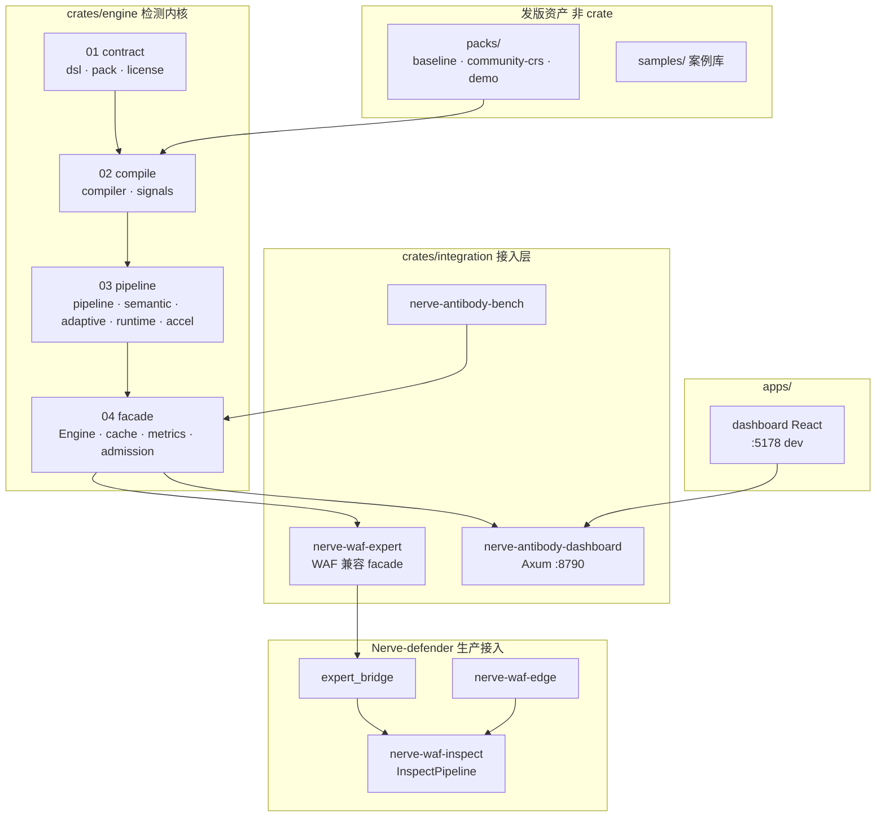
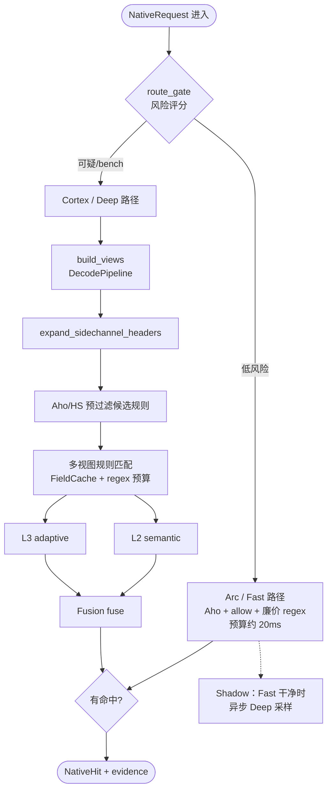
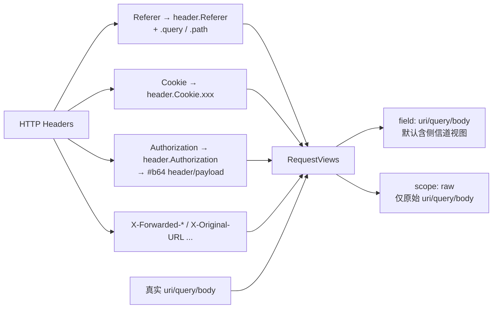
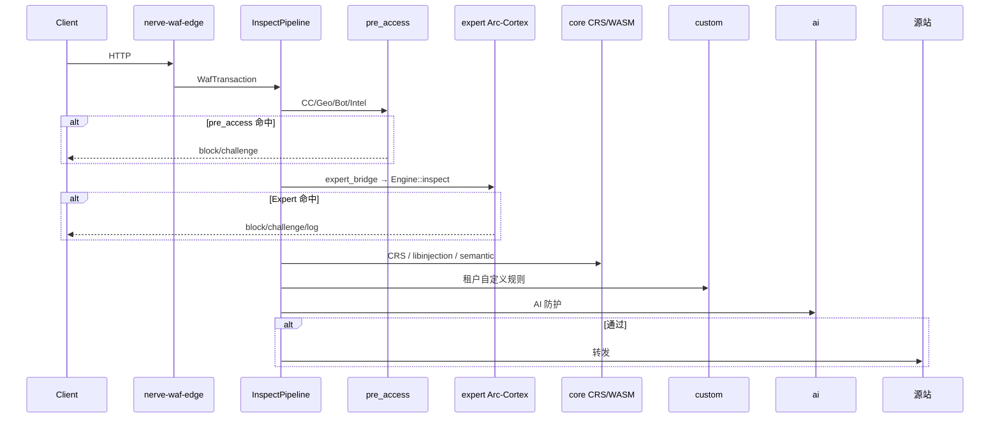
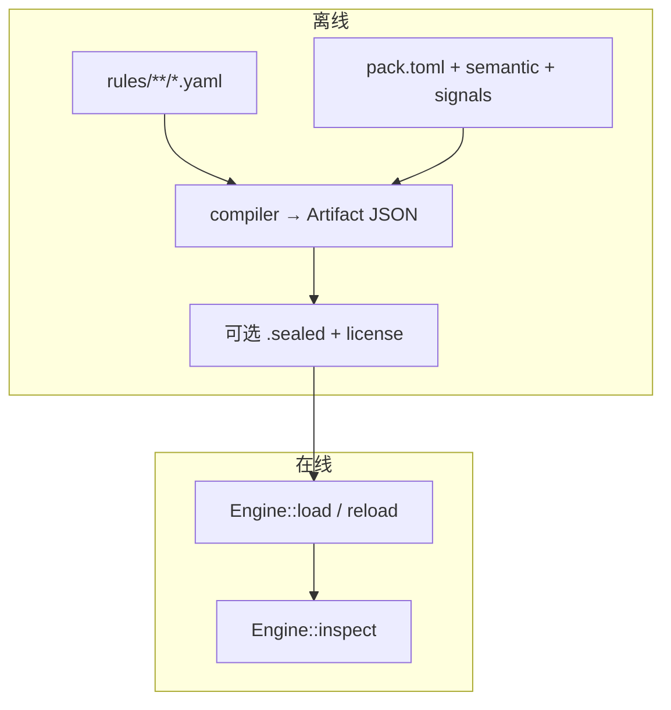

# Nerve Arc-Cortex（Antibody）系统架构总览

> 产品名：**Nerve Arc-Cortex**（弧-皮层检测引擎）· 仓库目录 **Nerve-antibody**  
> 本文：系统组成、架构分层、检测算法、请求链路、Header 侧信道（中文图解）。  
> 细分文档：[arc-cortex/README.md](./arc-cortex/README.md) · 实现细节：[ENGINE.md](./ENGINE.md)

---

## 1. 系统组成



| 路径 | 职责 |
|------|------|
| `packs/baseline/` | 自研规则 YAML + semantic + signals |
| `crates/engine/contract/` | 规则 DSL、pack 契约（无在线算法） |
| `crates/engine/compile/` | 离线编译 YAML → Program / Artifact |
| `crates/engine/pipeline/` | 在线 decode、匹配、L2/L3、Fusion |
| `crates/engine/facade/` | `Engine::inspect` 对外稳定 API |
| `crates/integration/nerve-waf-expert/` | WAF 同进程调用入口 |
| `apps/dashboard/` | 独立 Console（试打、bench、发版） |

---

## 2. 逻辑架构分层

```text
┌─────────────────────────────────────────────────────────┐
│  接入：WAF expert_bridge · Dashboard · Bench             │
└───────────────────────────┬─────────────────────────────┘
                            ▼
┌─────────────────────────────────────────────────────────┐
│  Facade：Engine + L0 admission + cache + metrics         │
│  · Arc 池（Fast）  · Cortex 池（Deep）  · Shadow 异步深扫   │
└───────────────────────────┬─────────────────────────────┘
                            ▼
┌─────────────────────────────────────────────────────────┐
│  Pipeline：Runtime Evaluator                             │
│  L1 规则签名 → L2 语义 → L3 自适应 → Fusion 融合动作      │
└───────────────────────────┬─────────────────────────────┘
                            ▼
┌─────────────────────────────────────────────────────────┐
│  Compile：DSL → IR → Program（low / medium / high）     │
└───────────────────────────┬─────────────────────────────┘
                            ▼
┌─────────────────────────────────────────────────────────┐
│  Contract：dsl · pack.toml · license                     │
└─────────────────────────────────────────────────────────┘
```

**依赖方向（硬约束）：** UI/API → Engine → Runtime → Compiler → Contract，禁止反向。

**引擎边界：** IP 黑白名单、Geo、连接限速在 Edge / Control / APISIX 等 **L0** 层，不在 Arc-Cortex L1 内。见 [BOUNDARY-IP-GEO-RATE.md](./BOUNDARY-IP-GEO-RATE.md)。

---

## 3. 检测算法分层（L0–L3 + Fusion）

```mermaid
flowchart LR
  subgraph L0 [L0 准入 facade/admission]
    CC[CC 限速]
    Bot[Bot]
    Geo[Geo]
  end

  subgraph L1 [L1 规则签名]
    Aho[Aho-Corasick 预过滤]
    Rules[YAML 规则\ncontains/regex/length/feature]
    Allow[allow 负分豁免]
  end

  subgraph decode [Decode 管线]
    Views[RequestViews]
    Side[Header 侧信道]
    B64[Base64 多轮解码]
    Struct[JSON/form/XML 拆参]
  end

  subgraph L2 [L2 语义 semantic]
    Sig[signatures.yaml]
    Ana[SQL/XSS/Path 启发式]
    Veto[semantic_veto 压分]
  end

  subgraph L3 [L3 自适应 adaptive]
    Route[route_gate 路由]
    Model[Linear/Engram 浅特征]
    Gate[贡献门闩\n无佐证不单独拦]
  end

  subgraph Fusion [Fusion v2/v3]
    F1[强 L1 → block]
    F2[弱信号 → challenge]
    F3[静态资源 → observe/pass]
  end

  L0 --> decode
  decode --> L1
  L1 --> L2
  L2 --> L3
  L3 --> Fusion
  Fusion --> Out[block / challenge / observe]
```



| 层 | 能否单独拦截 | 说明 |
|----|-------------|------|
| L0 | 能 | CC / Bot / Geo 等准入 |
| L1 | 能（过阈值） | 规则分 + allow 负分 |
| L2 | **不能** | 只加分或 veto |
| L3 | **不能** | 模型加分，须经 Fusion |
| Fusion | 最终动作 | block / challenge / observe |

**三档烈度：** 同一 pack 编译 low / medium / high 三份 Program；默认阈值示例：low=40、medium=36、high=32（见 `pack.toml` → `[policy.threshold_by_level]`）。

Fusion 决策优先级（摘要，详见 `crates/engine/pipeline/nerve-antibody-runtime/src/fusion.rs`）：

1. `observe_only` → observe  
2. 强 L1 过阈 → block（medium 纯 L1 无佐证可降为 challenge）  
3. 强 L2 可定罪语义 → block  
4. 弱 L1 ∧ 模型 / 解码佐证 → block 或 challenge  
5. 可解释可疑、不够硬拦 → **challenge**  
6. 静态资源无佐证 → observe（pass）

---

## 4. 单次 inspect 流程（引擎内部）



| 模式 | 触发 | 行为 |
|------|------|------|
| **Fast（Arc）** | route_gate 低风险 | 轻 decode，跳过深 L2/L3 |
| **Deep（Cortex）** | 可疑 / bench / `mode=deep` | 全量 decode + 侧信道 + L2 + L3 |
| **Shadow** | Fast 未命中 | 后台 Deep，不挡响应；FP 标注 → allow 草稿 |

环境变量：`NERVE_NATIVE_INSPECT_MODE`（auto/fast/deep）、`NERVE_NATIVE_SHADOW_DEEP`、`NERVE_NATIVE_INSPECT_POOL`。

---

## 5. Header 侧信道

**含义：** 将 Referer、Cookie、Authorization、X-Forwarded-* 等头展开并解码，生成与 `uri` / `query` / `body` 同级的 **RequestViews 切片**，供 L1 规则与语义层匹配（攻击 payload 常藏在头里）。



实现：`crates/engine/pipeline/nerve-antibody-pipeline/src/sidechannel.rs`  
字段匹配：`crates/engine/pipeline/nerve-antibody-runtime/src/eval/fields.rs`（`is_header_sidechannel_path`）

| 规则写法 | 匹配范围 |
|----------|----------|
| `field: uri`（无 scope） | 真实 URI **+** `header.Authorization#b64[1]` 等侧信道 |
| `field: uri` + **`scope: raw`** | **仅**真实请求路径 |
| `field: header` | 原始头行（CL/TE 走私等） |

**实践：** 协议走私用 `field: header`；URI `@` 混淆用 `field: uri` + `scope: raw`，避免 JWT claim 误报。

---

## 6. 生产请求链路（Nerve-waf）



默认流水线顺序（`InspectPipeline`，可被 semantic 配置覆盖）：

```text
pre_access → expert → core → custom → ai
```

WAF 接入代码：

- `Nerve-defender/crates/engine/nerve-waf-inspect/src/pipeline.rs` — 总编排  
- `Nerve-defender/crates/engine/nerve-waf-inspect/src/expert_bridge.rs` — Expert 桥接、challenge 映射  

| 环境变量 | 作用 |
|----------|------|
| `NERVE_EXPERT_PACK` / `NERVE_NATIVE_DEV_PACK` | 规则包目录 |
| `NERVE_EXPERT_ENGINE=off` | 关闭 Arc-Cortex，回退 WASM/Coraza |
| `NERVE_EXPERT_CHALLENGE_AS` | challenge → block / log |
| `NERVE_NATIVE_INSPECT_MODE` | auto / fast / deep |

---

## 7. 离线编译 vs 在线检测



加载期：`NativePack::load` → signals → RiskModel → compile ×3 levels → Evaluator。  
热路径：仅 `inspect`，预算内 regex / 熔断见 `[policy.pipeline]`。

---

## 8. 独立 Dashboard 链路

不经过 WAF Edge，用于规则试打与 bench：

```text
浏览器 :5178 (Vite dev)
    → /api 代理
    → nerve-antibody-dashboard :8790
    → Engine::inspect
    → packs/baseline | demo | community-crs
```

一键启动：`bash scripts/start-dashboard-dev.sh`  
详见 [arc-cortex/05-integration/dashboard.md](./arc-cortex/05-integration/dashboard.md)

---

## 9. 相关文档索引

| 主题 | 文档 |
|------|------|
| 分层架构（英文简版） | [arc-cortex/architecture.md](./arc-cortex/architecture.md) |
| 引擎能力全文 | [ENGINE.md](./ENGINE.md) |
| 术语 Arc/Cortex/L0–L3 | [arc-cortex/terminology.md](./arc-cortex/terminology.md) |
| Pipeline / decode | [arc-cortex/03-pipeline/pipeline.md](./arc-cortex/03-pipeline/pipeline.md) |
| Runtime / Fusion | [arc-cortex/03-pipeline/runtime.md](./arc-cortex/03-pipeline/runtime.md) |
| WAF Expert 接入 | [arc-cortex/05-integration/expert.md](./arc-cortex/05-integration/expert.md) |
| 规则编写 | [RULE-AUTHORING.md](./RULE-AUTHORING.md) |
| 引擎 crate 树 | [crates/engine/README.md](../crates/engine/README.md) |
| 误报处理 | [packs/baseline/FALSE_POSITIVES.md](../packs/baseline/FALSE_POSITIVES.md) |

---

## 10. 版本

文档与引擎同步维护；pack 版本见 `packs/baseline/pack.toml`。架构变更请同时更新本文与 [arc-cortex/architecture.md](./arc-cortex/architecture.md)。
